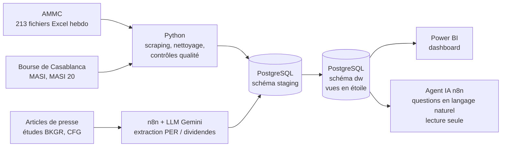

# Observatoire des marchés financiers marocains

**Comment évolue le marché financier marocain, qu'est-ce qui le fait bouger, et où un investisseur aurait-il eu intérêt à placer son argent ?**

Projet d'analyse de données de bout en bout : collecte automatisée, base PostgreSQL en schéma en étoile, analyses SQL / Python, dashboard Power BI, et automatisation avec n8n et une IA (extraction de données de presse, agent analyste).

> Phase 1 terminée : OPCVM (module 4) et marché actions (module 2). Données de septembre 2022 à octobre 2026.

---

## Résultats clés

**1. Les épargnants courent après la performance.**
Chaque semaine, le flux net vers les OPCVM Actions est corrélé à **+0,43** avec la performance du MASI des 4 semaines *précédentes*, mais à **−0,08** avec celle des 4 semaines *suivantes* (155 semaines). Les épargnants réagissent au marché sans l'anticiper.

| Année | MASI | Flux net vers les OPCVM Actions |
|---|---|---|
| 2024 | +21 % | +1,1 Md MAD |
| 2025 | +26 % (sommet à 20 234 le 27/08/2025) | **+10,6 Md MAD** |
| 2026 (jan.–oct.) | −8 % | −0,6 Md MAD |

Pondéré par les flux, l'argent est entré quand le MASI valait en moyenne **17 359** et en est ressorti à **16 312** : acheter cher, vendre moins cher.

**2. Le risque a fortement augmenté.**
La volatilité annualisée du MASI passe de **8,5 %** (2024) à **19,7 %** (2026) ; le pire drawdown atteint **−19,0 %** (03/03/2026).

**3. Les grandes valeurs font moins bien que le marché.**
Sur 3 ans, le MASI 20 gagne **+22,3 %** contre **+37,5 %** pour le MASI, avec un drawdown de **−27,8 %** contre −19,0 %.

**4. Le marché est devenu moins cher.**
Le PER prévu pour 2026 (BMCE Capital Global Research, Scope 40) est passé de **19,4x** (mai 2025) à **18,0x** (octobre 2026), sous sa moyenne historique sur 10 ans de **20,3x**.

<!-- Ajouter les captures dans docs/images/ -->


---

## Architecture




| Couche | Outils |
|---|---|
| Collecte et nettoyage | Python 3.13 : requests, BeautifulSoup, pandas, python-calamine |
| Stockage | PostgreSQL 18 : schéma `staging` (données nettoyées), schéma `dw` (vues en étoile) |
| Chargement | SQLAlchemy + psycopg |
| Analyse | SQL (fonctions de fenêtre, corrélations), pandas |
| Visualisation | Power BI Desktop (import, relations un-à-plusieurs, mesures DAX) |
| Automatisation et IA | n8n (auto-hébergé), Google Gemini, Telegram |

---

## Structure du dépôt

```
├── scripts/
│   ├── 01_telecharger_ammc.py     # scraping des fichiers hebdomadaires AMMC
│   ├── 02_inventaire_ammc.py      # dates, doublons, trous
│   ├── 03_extraire_ammc.py        # extraction des 4 tableaux de chaque fichier
│   ├── 04_charger_postgres.py     # chargement du schéma staging
│   ├── 05_charger_masi.py         # nettoyage et chargement des indices
│   └── config.example.py          # modèle de configuration (copier en config.py)
├── sql/
│   ├── 01_staging_ammc.sql        # tables staging AMMC
│   ├── 02_dw_phase1.sql           # schéma en étoile + vues d'analyse et KPI
│   ├── 03_dw_marche_actions.sql   # rendement, volatilité, drawdown par indice
│   └── 04_staging_valorisation.sql# table des PER et dividendes
├── n8n/
│   ├── workflow_per_marche.json   # extraction PER / dividendes (HTTP → HTML → LLM → contrôles → PostgreSQL → Telegram)
│   └── workflow_agent_analyste.json # agent IA avec outil SQL en lecture seule
├── dashboard/
│   └── observatoire_marches_maroc.pbix
├── data/processed/                # CSV nettoyés
└── docs/images/                   # captures
```

---

## Qualité des données : les pièges résolus

| Problème | Solution |
|---|---|
| Noms de fichiers AMMC incohérents, `.xls` et `.xlsx` mélangés | Liens lus sur chaque page, date lue dans le titre ou le nom |
| Cellule parasite dans une colonne sans en-tête | Colonnes lues par nom d'en-tête, jamais par position |
| Semaine du 11/07/2025 : bloc mal saisi (colonne en double) | Lecture de secours validée par « somme des catégories = Total » |
| « TOTAL » en majuscules dans les anciens fichiers | Libellé normalisé : l'encours n'est plus compté deux fois |
| « - » à la place d'un montant | Converti en 0 |
| Nombres à la française (`16 537,91`, `-1,57%`) | Conversion dédiée ; variation recalculée = variation publiée (0 écart sur le MASI) |
| Fichiers OneDrive non téléchargés localement | Lecture des octets en Python avant le parseur Excel |

Contrôles systématiques : 212 semaines sur 212 extraites, somme des catégories = Total sur toutes les semaines, clés primaires contre les doublons.

---

## Automatisation et IA avec n8n

**Extraction des PER et dividendes.** Aucune série officielle gratuite n'existe : les chiffres sont publiés dans des articles de presse. Le workflow n8n lit chaque article (requête HTTP + sélecteur CSS), confie le texte à un LLM avec une consigne précise et un exemple de réponse (few-shot), puis **valide la réponse en code** avant de l'insérer en base. 7 études, 21 valeurs, toutes vérifiées contre les articles.


Leçons tirées :
- un contrôle de format ne garantit pas le contenu (le modèle a renvoyé le schéma JSON au lieu des données, avec un « succès ») ;
- un LLM n'est pas déterministe : température à 0, date de l'article transmise, règles explicites ;
- l'IA n'écrit jamais directement en base : une couche de validation déterministe (liste fermée de périmètres, normalisation, arrêt sur toute valeur inconnue) protège la qualité ;
- résilience : nouvelles tentatives automatiques sur les erreurs 503.

**Agent analyste.** Un agent IA répond en français aux questions sur la base en écrivant lui-même ses requêtes SQL (*« Lequel est le plus risqué : MASI ou MASI 20 ? »*). Il se connecte avec un **compte PostgreSQL en lecture seule** (`GRANT SELECT`) : même si l'IA tentait une suppression, la base la refuserait.


---

## Reproduire le projet

1. Installer PostgreSQL, Python 3.13 et les dépendances : `pip install -r requirements.txt`
2. Créer la base `observatoire_maroc` et les schémas `staging` et `dw`
3. Copier `scripts/config.example.py` en `scripts/config.py` et renseigner le mot de passe
4. Exécuter `sql/01_staging_ammc.sql`, puis les scripts `01` à `05` dans l'ordre
5. Exécuter `sql/02_dw_phase1.sql`, `sql/03_dw_marche_actions.sql` et `sql/04_staging_valorisation.sql`
6. Ouvrir le dashboard Power BI et actualiser la connexion
7. (Optionnel) importer les workflows `n8n/*.json` dans n8n et créer ses propres identifiants (Gemini, Telegram, PostgreSQL)

L'historique du MASI s'exporte manuellement depuis le site de la Bourse de Casablanca (3 ans maximum).

---

## Limites

- Corrélations sur fenêtres de 4 semaines qui se chevauchent : significativité surestimée ; corrélation n'est pas causalité.
- Le MASI sert d'approximation de la valeur des fonds actions (dividendes non comptés).
- Historique du MASI limité à 3 ans (nov. 2023 → oct. 2026).
- PER et rendements : prévisions de sociétés de bourse, périmètres et méthodes différents selon la source.

---

## Feuille de route

| Phase | Modules | Statut |
|---|---|---|
| 1 | OPCVM, marché actions | ✅ Terminée |
| 2 | Contexte économique (HCP, Bank Al-Maghrib), taux et obligations | À venir |
| 3 | Introductions en bourse (SGTM, Laprophan…) face au MASI | À venir |
| 4 | Synthèse quantitative : portefeuilles types, risque, régressions | À venir |

---

## Sources

[AMMC](https://www.ammc.ma) · [Bourse de Casablanca](https://www.casablanca-bourse.com) · [Boursenews](https://boursenews.ma) (études BMCE Capital Global Research et CFG Bank)

## Auteur

**Ahmed Badi** — Ingénieur financier (EMSI Rabat), Data Analyst / Finance.
<!-- Ajouter le lien LinkedIn -->
