# Observatoire des marchés financiers marocains

**Comment évolue le marché financier marocain, qu'est-ce qui le fait bouger, et où un investisseur aurait-il eu intérêt à placer son argent ?**

Projet d'analyse de données de bout en bout : collecte automatisée (scraping), base PostgreSQL en schéma en étoile, transformations versionnées et testées avec dbt, analyses SQL / Python, dashboard Power BI, et automatisation avec n8n et une IA (extraction de données de presse, agent analyste).

> Les 6 modules sont terminés : OPCVM (4), marché actions (2), contexte économique (1), taux et obligations (3), introductions en bourse (5) et synthèse quantitative (6). Données de septembre 2022 à novembre 2026.

## Le site

**Site interactif : [observatoire-marches-maroc.vercel.app](https://observatoire-marches-maroc.vercel.app/)**
Il présente ces résultats en 7 pages (accueil, OPCVM et marché actions, contexte économique, taux et obligations, introductions en bourse, synthèse, méthode) avec des graphiques interactifs : filtre de période, choix de catégorie ou de portefeuille, bascule nominal / réel, tableaux triables. Il se met à jour chaque semaine sans intervention pour les données de l'AMMC. Le site ne calcule rien : tous les chiffres viennent de la base Supabase (vues `dw` et modèles dbt `analytics`), en lecture seule.

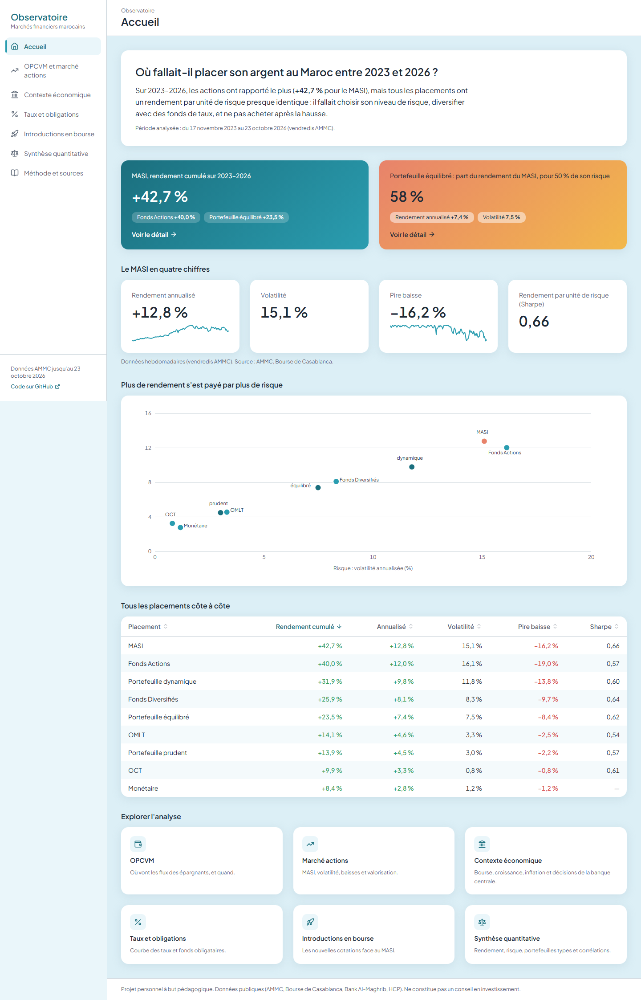

| OPCVM et marché actions | Taux et obligations | Synthèse |
|---|---|---|
| 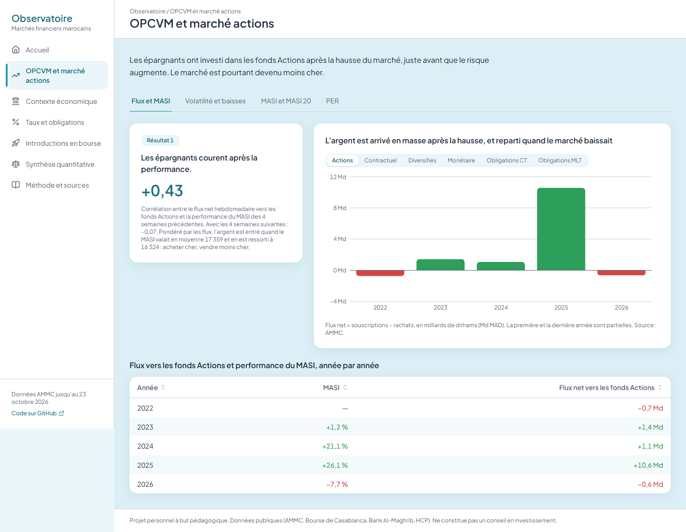 | 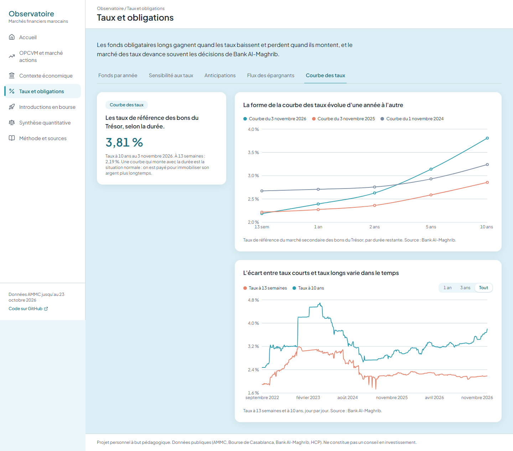 | 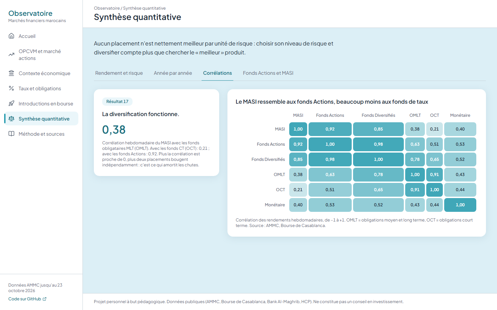 |

Le site s'affiche aussi sur téléphone : 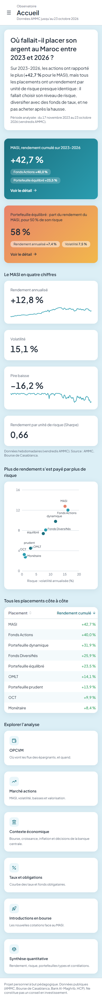

## En une phrase

Sur 2023–2026, les actions ont rapporté le plus (+42 % pour le MASI) mais tous les placements ont un rendement par unité de risque presque identique : il fallait choisir son niveau de risque, diversifier avec des fonds de taux, et surtout ne pas acheter après la hausse, ce que les épargnants marocains font pourtant, en OPCVM comme en IPO.

---

## Résultats clés

### OPCVM et marché actions (phase 1)

**1. Les épargnants courent après la performance.**
Chaque semaine, le flux net vers les OPCVM Actions est corrélé à **+0,43** avec la performance du MASI des 4 semaines *précédentes*, mais à **−0,08** avec celle des 4 semaines *suivantes* (155 semaines). Les épargnants réagissent au marché sans l'anticiper.

| Année | MASI | Flux net vers les OPCVM Actions |
|---|---|---|
| 2024 | +21 % | +1,1 Md MAD |
| 2025 | +26 % (sommet à 20 234 le 27/08/2025) | **+10,6 Md MAD** |
| 2026 (jan.–oct.) | −8 % | −0,6 Md MAD |

Pondéré par les flux, l'argent est entré quand le MASI valait en moyenne **17 359** et en est ressorti à **16 312** : acheter cher, vendre moins cher.

**2. Le risque a fortement augmenté.**
La volatilité annualisée du MASI passe de **8,5 %** (2024) à **19,7 %** (2026) ; le pire drawdown atteint **−19,0 %** (03/03/2026).

**3. Les grandes valeurs font moins bien que le marché.**
Sur 3 ans, le MASI 20 gagne **+22,3 %** contre **+37,5 %** pour le MASI, avec un drawdown de **−27,8 %** contre −19,0 %.

**4. Le marché est devenu moins cher.**
Le PER prévu pour 2026 (BMCE Capital Global Research, Scope 40) est passé de **19,4x** (mai 2025) à **18,0x** (octobre 2026), sous sa moyenne historique sur 10 ans de **20,3x**.

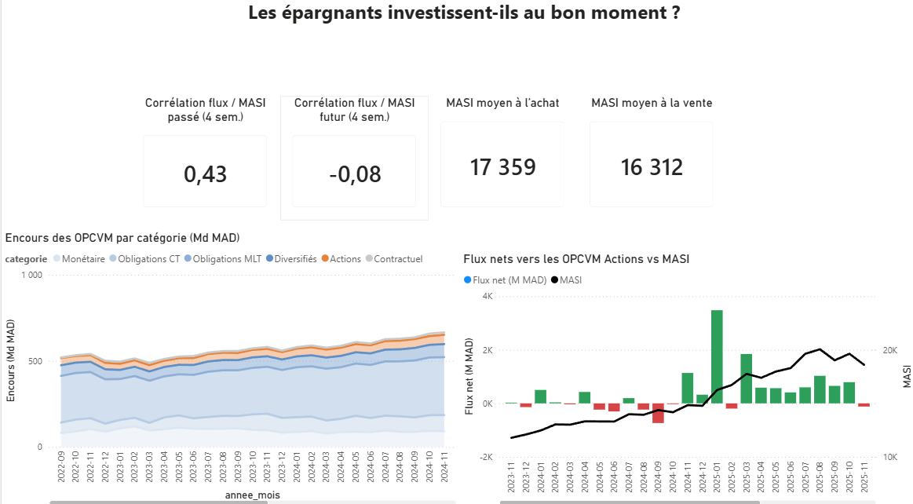
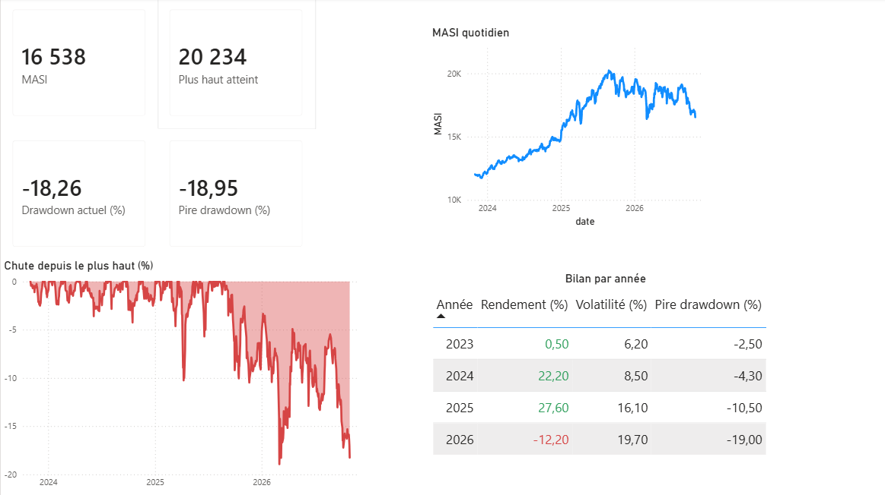

### Contexte économique (phase 2, module 1)

**5. La bourse bouge beaucoup plus que l'économie.**
Au 2e trimestre 2025, le MASI gagnait **+37,6 %** sur un an pour une croissance du PIB de **5,8 %** ; la baisse de 2026 s'explique par la valorisation (PER de 19,7x à 18,0x), pas par un ralentissement économique.

**6. L'inflation a peu pesé sur le rendement des actions.**
Fin novembre 2023 → fin septembre 2026 : MASI **+50,5 %** en nominal, **+47,4 %** en réel. Après le pic d'inflation de **+10,1 %** (février 2023), l'inflation est revenue autour de 0,5 % ; le vrai risque de la période a été la volatilité.

**7. Les baisses du taux directeur ont été suivies d'une hausse du MASI.**
Sur 20 séances après l'annonce, le MASI fait **+4,2 points** de mieux qu'en temps normal après une baisse, contre +0,7 point après un maintien (3 baisses seulement : corrélation, pas causalité).

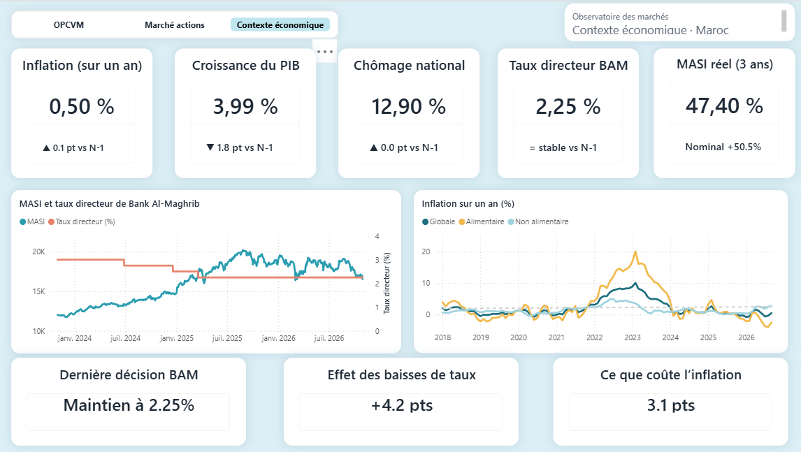

### Taux et obligations (phase 2, module 3)

**8. Les fonds obligataires longs suivent les taux, année après année.**

| Année | Taux 10 ans | Monétaire | Obligations CT | **Obligations MLT** |
|---|---|---|---|---|
| 2023 | +68 pb | +3,1 % | +3,5 % | **+1,6 %** (le pire) |
| 2024 | −68 pb | +3,2 % | +3,9 % | **+8,2 %** (le meilleur) |
| 2025 | −24 pb | +2,6 % | +3,0 % | **+5,4 %** (le meilleur) |
| 2026 (au 16/10) | +68 pb | +2,0 % | +2,1 % | **−1,6 %** (le pire) |

**9. Sensibilité implicite des fonds MLT : environ 4 à 4,5.**
Régression du rendement hebdomadaire sur la variation du taux 10 ans (201 semaines) : **+1 point de taux ≈ −4,1 %** pour les fonds obligataires MLT (R² = 0,57), contre −0,5 % pour les fonds CT et presque rien pour les fonds monétaires.

**10. Le marché anticipait les hausses de Bank Al-Maghrib, pas les baisses.**
À la veille des hausses de 2022–2023, le taux à 13 semaines était déjà **+41 à +88 pb** au-dessus du taux directeur ; avant les baisses de 2024–2025, il en était à peine éloigné (−2 à +8 pb).

**11. Les épargnants obligataires suivent moins la tendance que ceux des fonds actions.**
Corrélation des flux avec la performance passée : **0,15** pour les fonds MLT (contre 0,43 pour les fonds actions). Après +54 Md MAD de souscriptions en 2024–2025, les fonds MLT perdent **−17,5 Md MAD** en 2026, au profit des fonds monétaires (+34 Md) et CT (+24 Md).

### Introductions en bourse (phase 3, module 5)

**12. Les IPO récentes battent le MASI, pour ceux qui les ont souscrites.**
Sur les 6 IPO de décembre 2023 à juillet 2026, 5 font mieux que le MASI depuis leur introduction, de **+13 à +36 points**.

| IPO | 1re cotation | Sursouscription | 5 séances | 1 mois | Depuis l'IPO (03/11/2026) | Écart avec le MASI |
|---|---|---|---|---|---|---|
| CFG Bank | 18/12/2023 | 34,7x | +28,2 % | +38,4 % | +66,4 % | +31,2 pts |
| CMGP | 16/12/2024 | 37x | +38,7 % | +75,5 % | +25,0 % | +13,5 pts |
| Vicenne | 15/07/2025 | 64x | +61,0 % | +92,8 % | +21,6 % | +35,0 pts |
| Cash Plus | 08/12/2025 | 64x | +61,0 % | +57,0 % | +6,0 % | +17,3 pts |
| SGTM | 16/12/2025 | 34,1x | +61,0 % | +111,0 % | +24,8 % | +36,4 pts |
| T2S | 27/07/2026 | 43,75x | +7,1 % | +6,7 % | −9,4 % | −1,8 pt |

**13. Le premier jour est plafonné, la vraie hausse vient après.**
Cinq titres gagnent exactement environ +10 % à la première séance (seuil de variation de la Bourse), puis jusqu'à +61 % en 5 séances.

**14. Racheter une IPO en bourse après le premier mois fait perdre.**
Acheté au cours du 20e jour et gardé jusqu'au 03/11/2026 : SGTM **−40,9 %**, Vicenne −36,9 %, Cash Plus −32,5 %, CMGP −28,8 %, T2S −15,1 % ; seule CFG Bank gagne (+20,2 %). Et le souscripteur, servi à 1,5–3 %, gagne moins de 1,10 DH pour 100 DH demandés.

### Synthèse quantitative (phase 4, module 6)

**15. Plus de rendement, c'est autant plus de risque.**
Novembre 2023 → octobre 2026 (153 semaines), avec 3 portefeuilles types construits à partir des fonds (prudent 50/40/10, équilibré 20/40/40, dynamique 10/20/70 en monétaire / OMLT / actions) :

| Placement | Rendement cumulé | Rendement annualisé | Volatilité | Pire baisse | Ratio de Sharpe |
|---|---|---|---|---|---|
| MASI | +42,3 % | +12,7 % | 15,2 % | −16,2 % | 0,66 |
| Fonds Actions | +39,6 % | +12,0 % | 16,2 % | −19,0 % | 0,57 |
| Portefeuille dynamique | +31,7 % | +9,8 % | 11,8 % | −13,8 % | 0,59 |
| Portefeuille équilibré | +23,5 % | +7,4 % | 7,5 % | −8,4 % | 0,62 |
| Fonds obligataires MLT | +14,3 % | +4,7 % | 3,3 % | −2,5 % | 0,57 |
| Portefeuille prudent | +13,9 % | +4,5 % | 3,0 % | −2,2 % | 0,58 |
| Monétaire | +8,4 % | +2,8 % | 1,2 % | −1,2 % | — |

Tous les ratios de Sharpe sont entre 0,57 et 0,66 : aucun placement n'est « meilleur ». Le portefeuille équilibré garde 58 % du rendement du MASI avec la moitié de son risque.

**16. 2026 inverse le classement.** Après +22,6 % (2024) et +24,5 % (2025) pour les fonds actions, 2026 ne laisse gagner que les fonds CT (+2,1 %) et monétaires (+2,0 %) ; le portefeuille prudent limite la perte à −0,5 %, le dynamique perd −6,2 %.

**17. La diversification fonctionne.** Corrélation hebdomadaire du MASI : 0,92 avec les fonds actions, mais seulement **0,38** avec les fonds obligataires MLT et **0,21** avec les fonds CT.

**18. Les fonds actions ne battent pas l'indice.** +39,6 % contre +42,3 % pour le MASI, avec plus de volatilité, alors que le MASI ne compte pas les dividendes : l'écart correspond aux frais et aux choix de gestion.

---

## Architecture

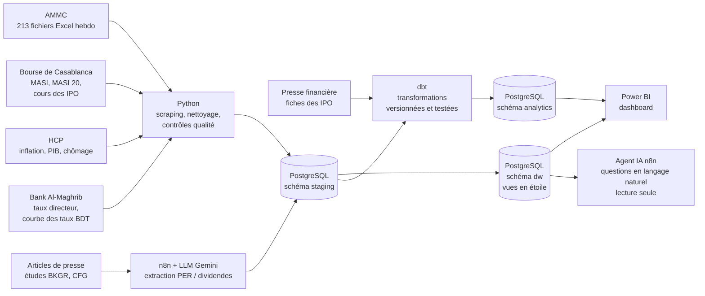

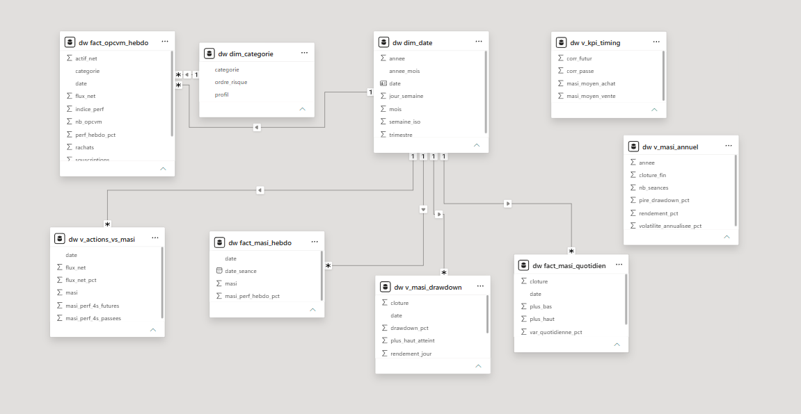

| Couche | Outils |
|---|---|
| Collecte et nettoyage | Python 3.13 : requests, BeautifulSoup, pandas, python-calamine |
| Stockage | PostgreSQL 18 : schéma `staging` (données publiées), `dw` (vues en étoile), `analytics` (modèles dbt) |
| Chargement | SQLAlchemy + psycopg, upsert (`ON CONFLICT`) |
| Transformation | dbt (dbt-core 1.11 + dbt-postgres) : 21 modèles et 1 seed, tests automatiques, documentation |
| Analyse | SQL (fonctions de fenêtre, interpolation, régression `regr_slope`, corrélations), pandas |
| Visualisation | Power BI Desktop (import, relations un-à-plusieurs, mesures DAX, thème JSON) |
| Automatisation et IA | n8n (auto-hébergé), Google Gemini, Telegram |
| Versionnement | Git / GitHub |

---

## Structure du dépôt

```
├── scripts/
│   ├── 01_telecharger_ammc.py      # scraping des fichiers hebdomadaires AMMC
│   ├── 02_inventaire_ammc.py       # dates, doublons, trous
│   ├── 03_extraire_ammc.py         # extraction des 4 tableaux de chaque fichier
│   ├── 04_charger_postgres.py      # chargement du schéma staging
│   ├── 05_charger_masi.py          # nettoyage et chargement des indices
│   ├── 06_extraire_macro.py        # HCP (inflation, PIB, chômage) + taux directeur BAM
│   ├── 07_collecter_courbe_bam.py  # scraping de la courbe des taux BAM (relançable)
│   ├── 08_charger_courbe_bam.py    # chargement de la courbe des taux (upsert)
│   ├── 09_charger_cours_ipo.py     # cours des IPO et du MASI (détection automatique des colonnes)
│   └── config.example.py           # modèle de configuration (copier en config.py)
├── sql/
│   ├── 01_staging_ammc.sql         # tables staging AMMC
│   ├── 02_dw_phase1.sql            # schéma en étoile + vues d'analyse et KPI
│   ├── 03_dw_marche_actions.sql    # rendement, volatilité, drawdown par indice
│   ├── 04_staging_valorisation.sql # table des PER et dividendes
│   ├── 05_staging_macro.sql        # indicateurs macroéconomiques
│   └── 06_staging_taux.sql         # courbe des taux de référence BAM
├── observatoire_dbt/               # projet dbt (schéma analytics)
│   ├── seeds/
│   │   └── ipo_operations.csv      # fiche de chaque IPO (prix, sursouscription…, une source par ligne)
│   └── models/
│       ├── sources.yml             # tables staging utilisées
│       ├── macro/                  # module 1 : inflation, PIB, chômage, décisions BAM, MASI réel
│       ├── obligations/            # module 3 : courbe interpolée, sensibilité, flux
│       ├── ipo/                    # module 5 : performance des IPO face au MASI
│       └── synthese/               # module 6 : classes d'actifs, portefeuilles types, corrélations
├── n8n/
│   ├── workflow_per_marche.json    # extraction PER / dividendes (HTTP → HTML → LLM → contrôles → PostgreSQL → Telegram)
│   └── workflow_agent_analyste.json # agent IA avec outil SQL en lecture seule
├── web/                            # site public : Next.js, Tailwind CSS, Recharts (lit dw et analytics, lecture seule)
├── .github/workflows/              # mise à jour hebdomadaire de l'AMMC + maintien de Supabase
├── dashboard/
│   ├── observatoire_marches_maroc.pbix
│   └── theme_observatoire.json     # thème Power BI
├── data/
│   ├── raw/macro/                  # fichiers HCP + taux_directeur_bam.csv
│   ├── raw/taux/                   # courbe_bam_brut.csv
│   ├── raw/ipo/                    # cours quotidiens des IPO et du MASI (Bourse de Casablanca)
│   └── processed/                  # CSV nettoyés
└── docs/images/                    # captures
```

---

## Qualité des données : les pièges résolus

| Problème | Solution |
|---|---|
| Noms de fichiers AMMC incohérents, `.xls` et `.xlsx` mélangés | Liens lus sur chaque page, date lue dans le titre ou le nom |
| Cellule parasite dans une colonne sans en-tête | Colonnes lues par nom d'en-tête, jamais par position |
| Semaine du 11/07/2025 : bloc mal saisi (colonne en double) | Lecture de secours validée par « somme des catégories = Total » |
| « TOTAL » en majuscules dans les anciens fichiers | Libellé normalisé : l'encours n'est plus compté deux fois |
| « - » à la place d'un montant | Converti en 0 (AMMC) ou en valeur vide (BAM) |
| Nombres à la française (`16 537,91`, `-1,57%`) | Conversion dédiée ; variation recalculée = variation publiée (0 écart sur le MASI) |
| Fichiers OneDrive non téléchargés localement | Lecture des octets en Python avant le parseur Excel |
| Variations AMMC « mensuelles » et « annuelles » = cumuls depuis le début du mois / de l'année | Rendements recalculés dans dbt à partir des indices |
| Courbe BAM : changement de méthode le 21/03/2023 (avant : dernière transaction de chaque titre, parfois vieille de plusieurs semaines) | Date de courbe = date demandée ; date de la valeur gardée à part ; analyses refaites depuis le 24/03/2023 |
| Courbe BAM : échéances différentes chaque jour | Interpolation linéaire à maturités fixes (13 semaines, 1, 2, 5, 10 ans) dans dbt |
| HCP : base chômage en retard, ligne « Source » erronée dans un fichier IPC | Signalé dans le rapport, non corrigé à la source |

Contrôles systématiques : 212 semaines sur 212 extraites, somme des catégories = Total sur toutes les semaines, clés primaires contre les doublons, tests dbt (`not_null`, `accepted_values`) à chaque construction.

---

## Automatisation et IA avec n8n

**Extraction des PER et dividendes.** Aucune série officielle gratuite n'existe : les chiffres sont publiés dans des articles de presse. Le workflow n8n lit chaque article (requête HTTP + sélecteur CSS), confie le texte à un LLM avec une consigne précise et un exemple de réponse (few-shot), puis **valide la réponse en code** avant de l'insérer en base. 7 études, 21 valeurs, toutes vérifiées contre les articles.

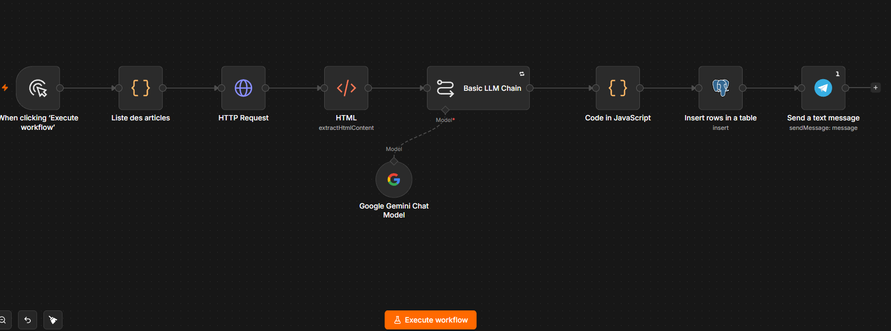

Leçons tirées :
- un contrôle de format ne garantit pas le contenu (le modèle a renvoyé le schéma JSON au lieu des données, avec un « succès ») ;
- un LLM n'est pas déterministe : température à 0, date de l'article transmise, règles explicites ;
- l'IA n'écrit jamais directement en base : une couche de validation déterministe (liste fermée de périmètres, normalisation, arrêt sur toute valeur inconnue) protège la qualité ;
- résilience : nouvelles tentatives automatiques sur les erreurs 503.

**Agent analyste.** Un agent IA répond en français aux questions sur la base en écrivant lui-même ses requêtes SQL (*« Lequel est le plus risqué : MASI ou MASI 20 ? »*). Il se connecte avec un **compte PostgreSQL en lecture seule** (`GRANT SELECT`) : même si l'IA tentait une suppression, la base la refuserait.

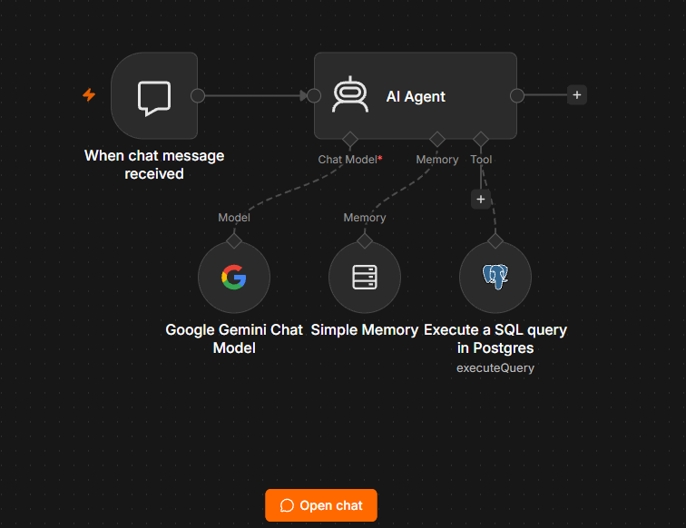

---

## Reproduire le projet

1. Installer PostgreSQL, Python 3.13 et les dépendances : `pip install -r requirements.txt`, puis `pip install "dbt-postgres==1.11.*"` (il installe aussi `psycopg2`, utilisé par les scripts 06, 08 et 09)
2. Créer la base `observatoire_maroc` et les schémas `staging` et `dw`
3. Copier `scripts/config.example.py` en `scripts/config.py` et renseigner le mot de passe
4. Exécuter `sql/01_staging_ammc.sql`, puis les scripts `01` à `05` dans l'ordre
5. Exécuter `sql/02_dw_phase1.sql`, `sql/03_dw_marche_actions.sql` et `sql/04_staging_valorisation.sql`
6. Exécuter `sql/05_staging_macro.sql` et `sql/06_staging_taux.sql`, puis les scripts `06` à `08`
7. Télécharger les cours des IPO et du MASI (Bourse de Casablanca → Market Data → Cours) dans `data/raw/ipo/`, puis lancer `09_charger_cours_ipo.py`
8. Depuis `observatoire_dbt/` : `dbt build` (seed des IPO, construction et tests du schéma `analytics`)
9. Ouvrir le dashboard Power BI et actualiser la connexion
10. (Optionnel) importer les workflows `n8n/*.json` dans n8n et créer ses propres identifiants (Gemini, Telegram, PostgreSQL)

L'historique du MASI s'exporte manuellement depuis le site de la Bourse de Casablanca (3 ans maximum). La collecte complète de la courbe des taux BAM prend environ 1 h 30 (une page par jour, pause d'une seconde entre deux requêtes).

---

## Limites

- Corrélations sur fenêtres de 4 semaines qui se chevauchent : significativité surestimée ; corrélation n'est pas causalité.
- Le MASI sert d'approximation de la valeur des fonds actions (dividendes non comptés).
- Historique du MASI limité à 3 ans (nov. 2023 → oct. 2026).
- PER et rendements : prévisions de sociétés de bourse, périmètres et méthodes différents selon la source.
- Décisions de Bank Al-Maghrib : peu de cas (3 hausses et 3 baisses depuis 2022), conclusions fragiles.
- Courbe des taux : rupture de méthode BAM en mars 2023 ; données hebdomadaires seulement entre mars 2023 et 2025 ; 5 semaines sans courbe (vendredis fériés).
- Le taux à 13 semaines dépend aussi des besoins de financement du Trésor, pas seulement des anticipations sur Bank Al-Maghrib.
- IPO : 6 cas seulement, pas de classement avant 2023 (historique gratuit de 3 ans) ; fiches saisies depuis la presse.
- Synthèse : 3 ans dont deux années de forte hausse ; indices de catégorie AMMC (moyenne de fonds différents) ; ni frais d'entrée ni impôts.

---

## Feuille de route

| Phase | Modules | Statut |
|---|---|---|
| 1 | OPCVM, marché actions | ✅ Terminée |
| 2 | Contexte économique (HCP, Bank Al-Maghrib), taux et obligations | ✅ Terminée |
| 3 | Introductions en bourse (CFG Bank, CMGP, Vicenne, Cash Plus, SGTM, T2S) face au MASI | ✅ Terminée |
| 4 | Synthèse quantitative : classes d'actifs, portefeuilles types, risque, corrélations | ✅ Terminée |
| 5 | Site public interactif (Next.js, Supabase, Vercel) et mise à jour hebdomadaire de l'AMMC (GitHub Actions) | ✅ Terminée |
| Suite | Laprophan (cotation fin novembre 2026) ; courbe des taux automatisée si Bank Al-Maghrib l'autorise ; version anglaise ; agent analyste en ligne | À venir |

---

## Sources

[AMMC](https://www.ammc.ma) · [Bourse de Casablanca](https://www.casablanca-bourse.com) · [Bank Al-Maghrib](https://www.bkam.ma) · [HCP](https://www.hcp.ma) · [Boursenews](https://boursenews.ma) (études BMCE Capital Global Research et CFG Bank)

## Auteur

**Ahmed Badi** — Ingénieur financier (EMSI Rabat), Data Analyst / Finance.
<!-- Ajouter le lien LinkedIn -->
